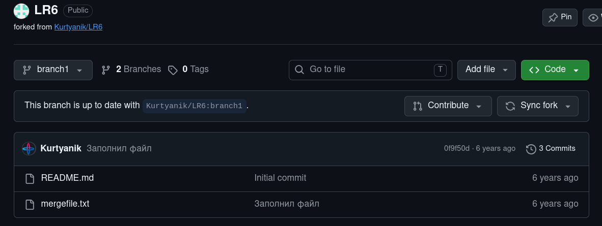
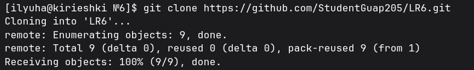
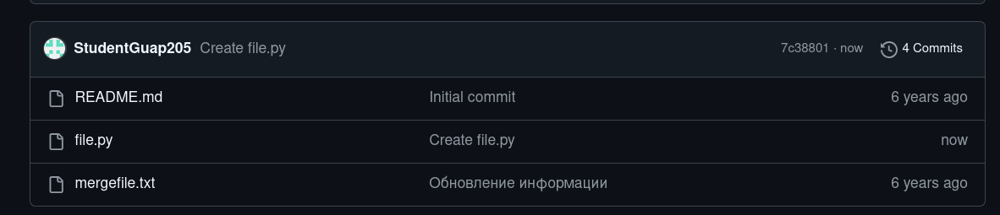
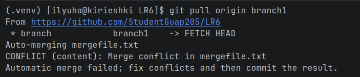
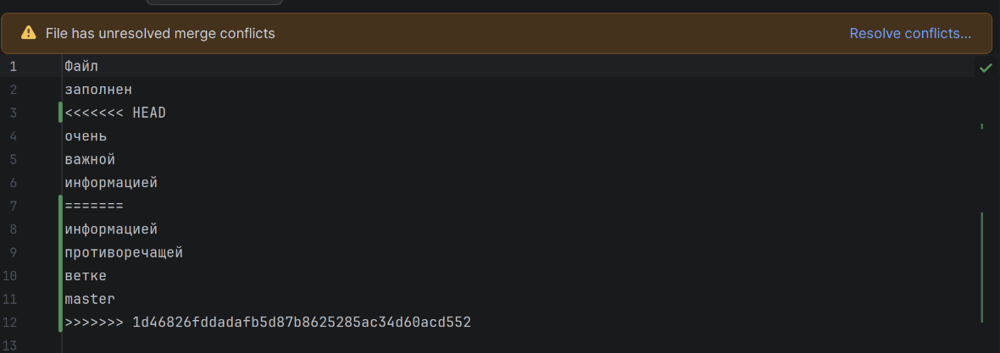
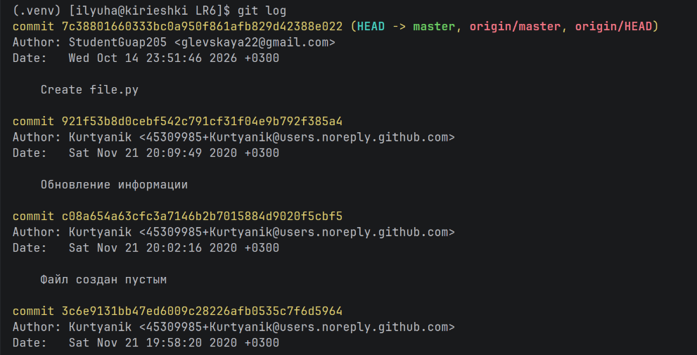
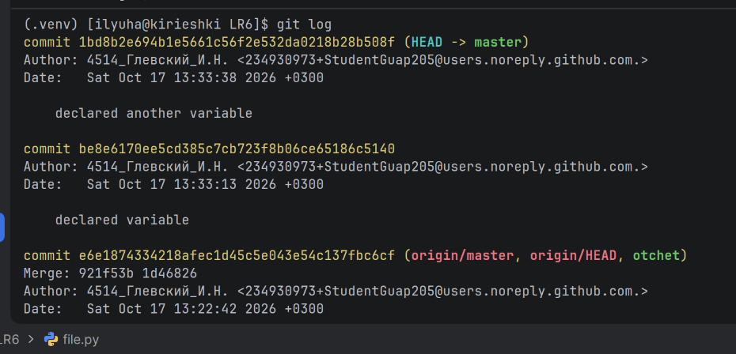
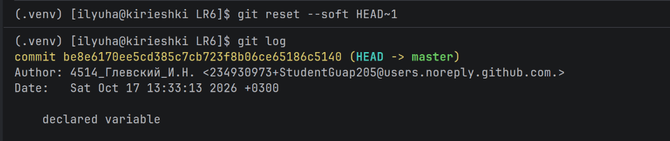
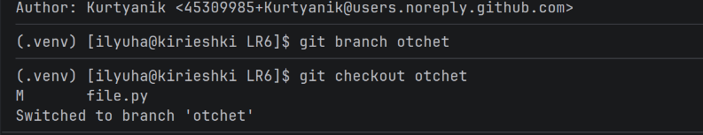
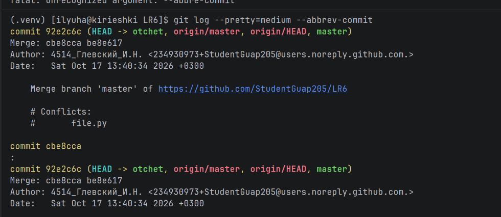

# LR6

Лабораторная работа №6

## **1 Цель работы**

Целью работы является изучение базовых возможностей системы управления версиями, опыт работы с Git Api, опыт работы с локальным и удаленным репозиторием.

## **2 Последовательность выполнения работы**

Войдём в аккаунт на Github и сделаем копию из [https://github.com/Kurtyanik/LR6/](https://github.com/Kurtyanik/LR6/) в личное хранилище (рис. 1)

Рисунок 1 – Копия репозитория в личное хранилище

Скопируем репозиторий теперь на сам компьютер через git clone (рис. 2)

Рисунок 2 - Клонирование репозитория на компьтер

Настроим клиент git через git config, введя имя и почту (рис. 3)

Рисунок 3 - Настройка клиента git

Добавим файл через интерфейс Github и подтянем изменения в локальный репозиторий (рис. 4 и 5)

Рисунок 4 - Добавление файла через интерфейс Github

Рисунок 5 - Подтягивание изменений в локальный репозиторий

Как можно заметить, возникает конфликт, решаться он будет в графическом интерфейсе от IDE, в котором проводится работа с репозиторием. Причина конфликта предоставлена на рисунке 6.

  

Рисунок 6 - Причина конфликта при попытке git pull

Решаем этот конфликт, принимая входящие изменения

Теперь посмотрим историю изменений через git log (рис. 7)

Рисунок 7 - Просмотр истории изменений

Сделаем несколько коммитов с комментариями (рис. 8)

Рисунок 8 - Коммиты с комментариями

Откатим один коммит через git reset --soft HEAD~1 (рис. 9)

Рисунок 9 - сброс коммита через git reset

Создадим отдельную ветку для загрузки отчёта (рис. 10)

Рисунок 10 - Создание ветки для отчёта

Теперь выведем отформатированную историю коммитов (рис. 11)

Рисунок 11 - отформатированная история коммитов

## Выводы

В рамках выпонения лабораторной работы был получен опыт работы с базовыми возможностям системы управления версиями, с Git Api, с локальным и удаленным репозиторием.
